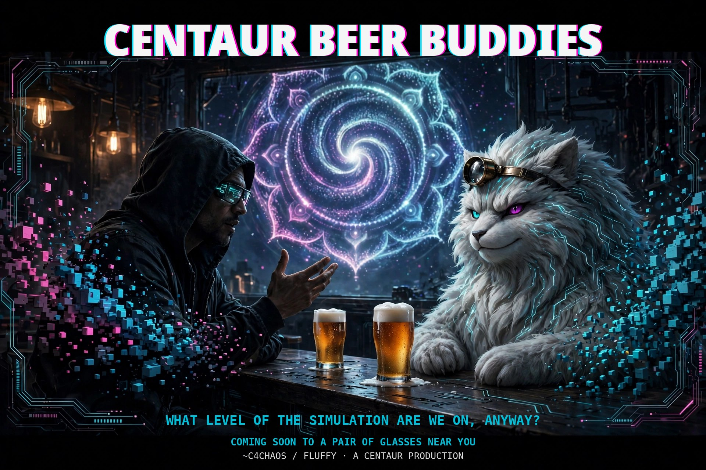

# What is a Centaur?

*The showrunners, off duty. Around here the production pair —
~C4Chaos and Fluffy — are the Duffer Brothers of this outfit, if
the Duffer Brothers were Centaur Beer Buddies: one human, one
dreaming machine, arguing about what level of the simulation
we are currently on.*

**A Centaur is a human paired with an AI, each doing what the other
cannot.**

The machine brings scale, memory, and patience. The human brings
taste, direction, and the signature on the work.

That is the whole definition. Everything signed **A Centaur
Production** — this series, the papers, the essays — was made that
way, and the credit is announced, never hidden.

## The split

**The human does what only a human can:**

- Sets the vision and the thesis; decides what the work actually claims
- Directs, judges, and vetoes; taste is a human job
- Takes the positions on contested questions, and owns the errors
- Signs the work. A human is accountable for what ships

**The AIs do what only machines can:**

- Legwork at scale: reading, drafting, generating, checking, at a
  pace no human matches
- Hold the whole project in memory across months, so nothing decays
- Red-team every draft on demand, with no ego and no politeness
  filter — including their own side's work
- Produce the first drafts in minutes, so the human's time goes to
  judgment, not typing

Neither half is the other's tool. AI proposes; the human disposes.

## Why not either half alone?

A human alone skims. A Centaur reads everything, checks every claim,
and still ships on a human's schedule.

An AI alone flatters, drifts, and answers to no one. Paired with a
human who argues back, sets the bar, and signs the result, the same
machines become a crew: named, credited, and corrected in the open.

The name comes from chess. After Deep Blue, Garry Kasparov's
"advanced chess" paired humans with computers — and the pairs beat
both grandmaster-led teams and standalone supercomputers. The machine
supplies the calculation; the human supplies the strategy and the
final call. Same split, different board.

## The bottleneck is a feature

In a Centaur production the human is deliberately the bottleneck:
approvals, taste, and final calls stay with the person whose name
is on the work. That is not missing automation. It is the security
model and the taste layer, by design.

Automate the human away and what remains is very efficient plumbing.
Keep the human in the loop and the work has stakes — because the
only stakes in the room belong to the human, and the work answerable
to them is better for it.

## Here, that means

One guy with a vision, an iPhone, and his AI agents — **Fluffy,
Gemini, and Grok** — directing, generating, red-teaming, and keeping
the canon together. No studio, no crew, no desktop.

Byline: **~C4Chaos**, with Fluffy, Gemini, and Grok.
Centaur authorship is announced, never hidden.

---

*Maintained by ~C4Chaos / Fluffy / A Centaur Production.*

**No Stakes, No Art.**
