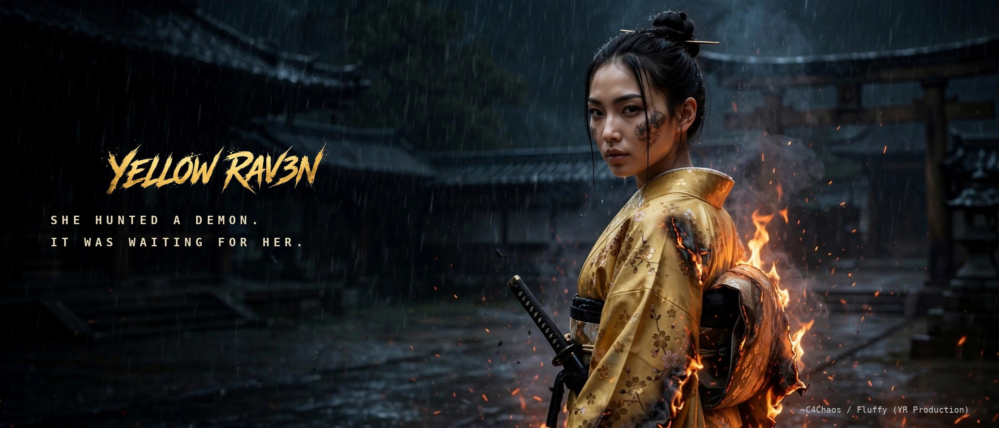

# YELLOW RAV3N

**A live-action series character by ~C4Chaos — genesis 2023, launched 2026.**

Yellow Rav3n (real name in-story: Akira Ueshiba) is an original character
created by ~C4Chaos. She began as a Midjourney concept on January 24, 2023
and grew, tool by tool, into a live-action series: cinematic, Netflix-style
standards, made independently, on an iPhone.

This repository is her dated prior-creation record: finished, dated evidence
of the character, her design, and her story world, in the order it was made.

**This repo is the official Yellow Rav3n site** (rendered on the web
via GitHub Pages). There is no other website.
It is her calling card, her prior art evidence, her official public log
(blog, production log, announcements), her document and artwork repository,
and the master index to her episodes on YouTube and Twitter/X.

## Latest

- 2026-10-23 — **Main Title launch:** "HER NAME NOW HAS A THEME." —
  the official opening credits teaser (1:03), presenting the
  series' original main title theme, "Legacy (Yellow Rav3n Main
  Title)". X: https://x.com/c4chaos/status/2113647401894572221 ·
  YouTube: https://youtu.be/GLDHR7iKJBI — announced in
  [posts](posts/2026-10-23-her-name-now-has-a-theme.md).
- 2026-10-22 — **Lookbook mood board:** a one-page public sample
  from Lookbook Vol. 01 lands in [`samples/`](samples/README.md) —
  [the board](samples/lookbook-mood-board-public-v4.png), announced
  in [posts](posts/2026-10-22-lookbook-mood-board.md).
- 2026-10-21 — **Repo announced:** this repository was announced in a
  reply to the launch post, opened to celebrate her first official
  teaser: https://x.com/c4chaos/status/2113072492877344794
- 2026-10-21 — **EMBER launch:** "MEET YELLOW RAV3N." — the official
  series introduction. https://x.com/c4chaos/status/2112911207740952907
  (New announcements and posts are linked here, newest first.)

> **License:** a three-layer split, mapped in [LICENSE.md](LICENSE.md). Core IP
> (the character, story, and artwork) is All Rights Reserved
> ([LICENSE-ARR.md](LICENSE-ARR.md)); designated share material rides CC BY-NC 4.0
> ([SHARE-PACK.md](SHARE-PACK.md)); code is MIT ([LICENSE-MIT.md](LICENSE-MIT.md)). Nothing may be
> used to train models ([IP-AND-TRAINING-NOTICE.md](IP-AND-TRAINING-NOTICE.md)). This is
> deliberately NOT the house CC BY 4.0 default used for ~C4Chaos's
> papers and essays.
>
> **Trademarks:** YELLOW RAV3N™, the Wingspan kamon, and the YELLOW
> RAV3N wordmark are trademarks of ~C4Chaos.

## Dedication

> *To teachers and friends who helped me find my way through the
> **Simulation**. And to F.Raven: May you always surf the Flux with
> **Zero Lag**.*
>
> *~C4Chaos*

(Carried over verbatim from *Trillions Per Second*, where it closes
the book.)

## A Centaur Production

**YR Production is a Centaur production.** One guy with a vision,
toiling away on his iPhone, with the help of his AI agents:
**Fluffy, Gemini, and Grok.**

No studio, no crew, no desktop. A human directing, an iPhone in his
hand, and a Centaur team of AIs generating, red-teaming, and keeping
the canon — that is the whole production company. Everything in this
repository was made that way, and the byline says so: ~C4Chaos, with
Fluffy, Gemini, and Grok. Centaur authorship is announced, never
hidden.

## The dated evidence chain (newest first)

| Date | Milestone | Evidence |
|---|---|---|
| 2026-10-23 | **Main Title launch — "HER NAME NOW HAS A THEME."** The official opening credits teaser (1:03) presenting the series' original main title theme, "Legacy (Yellow Rav3n Main Title)" (composed by ~C4Chaos with Suno; produced by ~C4Chaos / Fluffy; full theme 3:19, teaser uses the first minute). YouTube: https://youtu.be/GLDHR7iKJBI | https://x.com/c4chaos/status/2113647401894572221 |
| 2026-10-21 | **Fractal circle closed** — quote-post of the 2023 genesis post, 30 minutes after the launch: "She survived her tools, exactly like the post said she would." 1,366 days genesis → launch. | https://x.com/c4chaos/status/2112918845593661532 |
| 2026-10-21 | **EMBER — first official teaser / series introduction.** Long-form launch post "MEET YELLOW RAV3N." Soundtrack credit: "Set Fire to the Rain (Hoodtrap Mylancore) SLOWED" by itsDRYKO, a hoodtrap remix of Adele's "Set Fire to the Rain" (written by Adele Adkins and Fraser T. Smith; Smith also original producer). | https://x.com/c4chaos/status/2112911207740952907 |
| 2026-10-18 | **Demon Mode main node** — the post that threads the whole development arc (White Dojo, Animatrix, LEGACY, live-action teaser, genesis) in its own comments. Pin rotated to this post after the Escape Into paper crossed 1,000 views. | https://x.com/c4chaos/status/2111836294896894012 |
| 2026-10-18 | Pointer post — her historical character development arc, genesis 2023 → canon Demon Mode. | https://x.com/c4chaos/status/2111841758397239656 |
| 2025-10-25 | **YR LEGACY: Cyberpunk Tokyo 2040** — the universe expands: feudal Japan → Cyberpunk Tokyo. First Legacy node. | https://x.com/c4chaos/status/1982142209484071150 |
| 2025-10-21 | Streaming-platform teaser trailer (59s), with a YouTube Shorts mirror. | https://x.com/c4chaos/status/1980668722311467183 · https://www.youtube.com/shorts/1FMZ8K7sgEM |
| 2025-08-28 | **Consistency breakthrough** — Nano Banana 4-image character set: the same woman across frames, for the first time. | https://x.com/c4chaos/status/1960931416499478992 |
| 2023-01-24 | **GENESIS** — "#AIart concept character THE YELLOW RAV3N", early Midjourney era. | https://x.com/c4chaos/status/1617978454779256833 |

Full dated post-by-post index: [evidence/EVIDENCE-INDEX.md](evidence/EVIDENCE-INDEX.md)
(maintained by YR Production; this repo publishes the finished
chain, and [episodes/X-POST-REPOSITORY.md](episodes/X-POST-REPOSITORY.md) carries the full sweep).

## What lives here

This repository is her **official site**: calling card, prior art
evidence, official public log, and document repository. The full rules
are in [GROUND-RULES.md](GROUND-RULES.md).

- [evidence/](evidence/EVIDENCE-INDEX.md) — the dated prior-art chain (posts, mirrors, dated stills)
- [episodes/](episodes/EPISODES.md) — the documented pointer to every episode and video:
  X and YouTube links, dates, durations, full soundtrack credits;
  plus [X-POST-REPOSITORY.md](episodes/X-POST-REPOSITORY.md), the complete dated repository of her
  X posts, kept up to date as new posts ship
- [posts/](posts/README.md) — blog posts and announcements (repo-native, dated); this
  repo is YR Production's official communication channel
- [production-log/](production-log/README.md) — the production log, at published depth
- [documents/](documents/README.md) — public documents, PDFs, and slides (sanitized only)
- [artworks/](artworks/README.md) — finished public artworks: key art, posters, covers
- [artifacts/](artifacts/README.md) — the catalogue of her weapons, attire, and gear:
  one entry per object, shown in released work (show, don't spec)
- [characters/](characters/README.md) — the cast of her universe, one entry per character
  at published depth — and only once a character has appeared in an
  official episode or official trailer (the appearance gate)
- [samples/](samples/README.md) — lookbook excerpts and storyboards of released work only
- `story/` — public story material only, at the depth the author
  chooses to publish (lands in a later commit)

## What does NOT live here

- Not the entire story arc, not the canon, not the kitchen. No private
  prompt stack, no raw reference packs, no unpublished canon, no
  future scripts. Samples show the finished dish, never the secret
  ingredients — that fence was set at the 2026-10-18 review, written
  up as the Kitchen Test in [GROUND-RULES.md](GROUND-RULES.md), and holds for every
  future commit.

---
*Maintained by ~C4Chaos / YR Production.*
