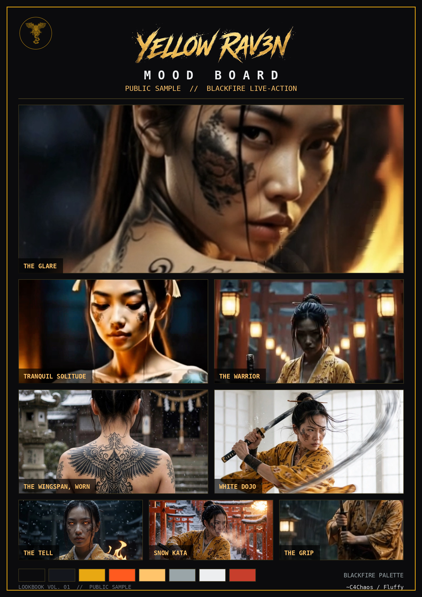

# YELLOW RAV3N

**Real name (in-story): Akira Ueshiba.**
An original character created by ~C4Chaos. Genesis: January 24, 2023,
as a Midjourney concept in the early days of AI art. She grew, tool by
tool, into the lead of a live-action series: cinematic, Netflix-style
standards, made independently, on an iPhone.

**First official appearance:** EMBER — the official series
introduction, 2026-10-21.
https://x.com/c4chaos/status/2112911207740952907
(Her full public development history, 2023 → launch, is indexed in
[`episodes/X-POST-REPOSITORY.md`](../episodes/X-POST-REPOSITORY.md).)

*The public mood board from Lookbook Vol. 01 (2026-10-22), filed in
[`samples/`](../samples/README.md).*

## As the audience has met her

- A samurai in feudal Japan, in the house style of the series:
  live-action Hollywood, *Kill Bill* in ancient Japan; design
  language BLACKFIRE Live-action.
- Golden-yellow kimono with a cherry blossom (sakura) design, black
  obi; hair in a tight topknot with a single thin hairpin. Her
  weapons and attire are catalogued in [`artifacts/`](../artifacts/).
- The **Wingspan tattoo**: wings across her back, shoulder to
  shoulder. Her emblem, the Wingspan kamon, is the lead mark of the
  series.
- Black eyes — except for the ember tell: when the fire in her
  stirs, her eyes burn ember. In EMBER it is the only supernatural
  sign she shows.
- She hunts a demon. The series tagline is its own summary:
  *SHE HUNTED A DEMON. IT WAS WAITING FOR HER.*

What she is, beyond what released work has shown, is hers to reveal
on screen, in the episodes to come — not in this file.

---
*Published-depth entry, 2026-10-21. Character and likeness: All
Rights Reserved (see `../LICENSE-ARR.md`). YELLOW RAV3N™ and the
Wingspan kamon are trademarks of ~C4Chaos.*
