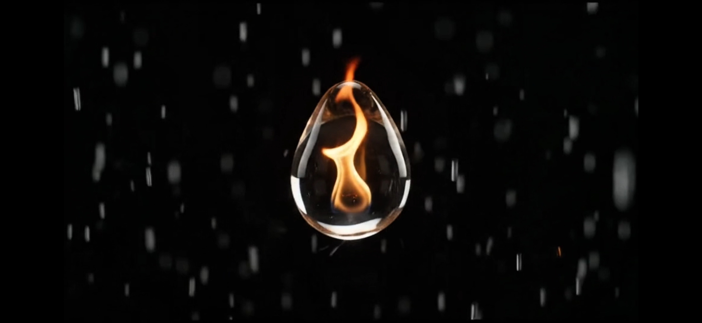

# HER NAME NOW HAS A THEME.

*2026-10-23 — the official opening credits teaser.*

EMBER introduced Yellow Rav3n. Now she gets the other half of a
series: an opening, and a theme of her own.

Not a borrowed track. Not a remix. An original main title,
composed for her and owned by the house that built her. The
teaser carries only the first minute of the theme; the full
theme runs 3:19, and the rest stays in the vault for now. Slow
burn, slow reveal, even in the runtime.

*A frame from the opening credits teaser.*

- **The launch post on X:** https://x.com/c4chaos/status/2113647401894572221
- **On YouTube:** "LEGACY (Yellow Rav3n Main Title)" (1:03) — https://youtu.be/GLDHR7iKJBI
- **Theme:** "Legacy (Yellow Rav3n Main Title)" — composed by
  ~C4Chaos with Suno; produced by ~C4Chaos / Fluffy (a Centaur
  production). Full theme: https://suno.com/s/buYngVPwqlu78svS

- **Making of:** [Production Log 003 — Legacy: the main
  title theme](../production-log/prodlog_003.md) ·
  [Director's Note 006 — A theme, paid for](../directors-notes/dirnote_006.md)

The launch post carries the EMBER launch as its quoted post:
the introduction, then the theme, in that order.

— ~C4Chaos / Fluffy (*A Centaur Production*)
