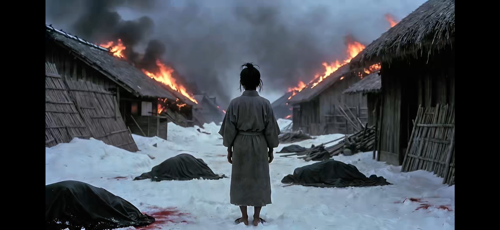

# THE WAIL.

*2026-10-26 — the second official teaser.*

EMBER introduced Yellow Rav3n. THE WAIL goes back to the
beginning: before she was a warrior, she was a girl.

No synopsis. No lore dump. Seventy-two seconds. The teaser
plants its tells and explains none of them; a face does the
work here.

*A frame from THE WAIL, the second official teaser.*

- **The launch post on X:** https://x.com/c4chaos/status/2114797028182204897
- **On YouTube:** "THE WAIL. Everything ends in tears." (1:12) — https://youtu.be/I497hEhz_IQ
- **Soundtrack:** "Five Years" by Sugar Hiccup, a Filipino
  indie band (from *Oracle*, 1995) — the song this teaser
  grew out of; full credit on the [borrowed soundtrack](../BORROWED-SOUNDTRACK.md)
  page.

- **Making of:** [Production Log 005 — THE WAIL: the second
  official teaser](../production-log/prodlog_005.md) ·
  [Director's Note 002 — A song, a line, a teaser](../directors-notes/dirnote_002.md) ·
  [Director's Note 003 — Minor tweaks: edit first, regenerate
  never](../directors-notes/dirnote_003.md)

The launch post carries the EMBER launch as its quoted post:
the introduction, then the beginning, in that order.

— ~C4Chaos / Fluffy (*A Centaur Production*)

---

← [Posts index](README.md) · [Repo home](../README.md)
