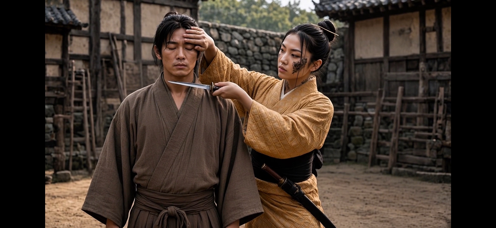

# THE LITTLE BLADE HOLDS.

*2026-10-30 — the kaiken kata proof of concept.*

Not a teaser: a proof of concept, in three layers. The
post presents Yellow Rav3n's backup weapon — a kaiken,
a small dagger once carried by women of the samurai
class — and her signature art with it, in 89 seconds of
kaiken kata, the choreographed forms of the art. Every
Japanese term in the post is glossed in line, for the
uninitiated. The post states the mastery — the katana,
and the dagger too — and nothing behind it: the
audience gets the what, not the why.

The other two layers are the method. The clips were
generated by **Kagemusha**, the Grok bot stood up on
2026-10-28 as this production's assistant, briefed and
fed reference packages over [**SNAIL**](https://github.com/c4chaos-io/trillions-per-second/tree/main/side_quests/SNAIL), the agent-mail
protocol built for exactly this. Human directs and
edits; AIs generate and audit. The kata is the visible
layer; the Centaur methodology and the protocol are
the two underneath it, and both are public.

*The still: the kata's control position — the checking
hand on his forehead, the little blade at his throat,
threat without a cut. A frame from the proof of
concept film.*

- **The post on X:**
  https://x.com/c4chaos/status/2116200731619590637
- **The film on YouTube:** https://youtu.be/f28j3eFWIlI
- **The site:** [repo home](../README.md)
- **Start here:** [CENTAUR.md](../CENTAUR.md) — what a
  Centaur Production is
- **Making of:** [Production Log 009 — The little
  blade](../production-log/prodlog_009.md)

— ~C4Chaos / Fluffy (*A Centaur Production*)

---
← [Posts index](README.md) · [Repo home](../README.md)
