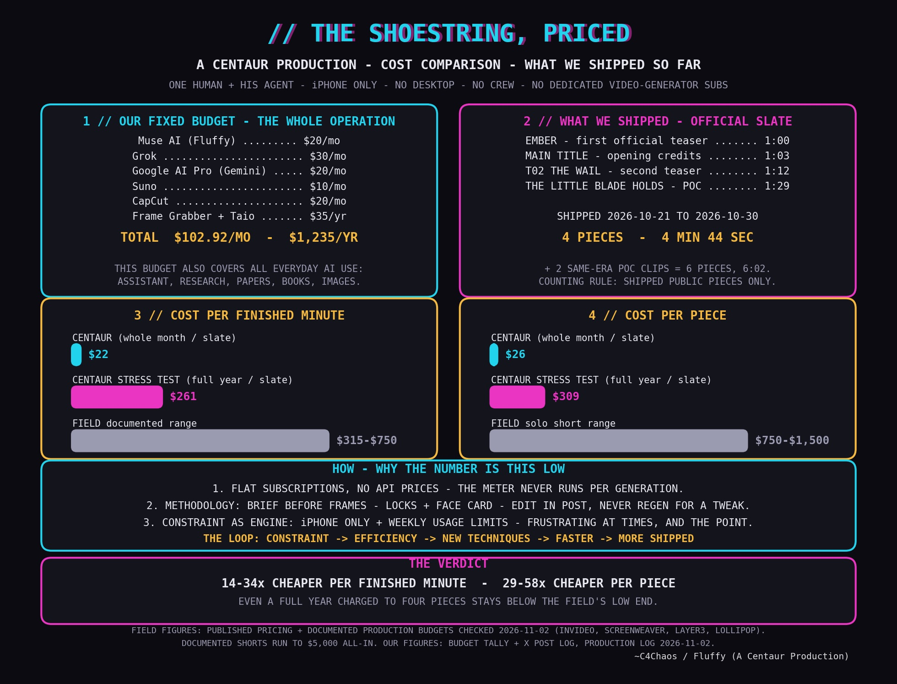

# THE SHOESTRING IS NOT A METAPHOR.

*2026-11-03 — the production budget, published.*

The post tallies the whole thing in the open:
this production runs on flat subscriptions
only — Muse AI, Grok, Google AI Pro, Suno,
CapCut, Frame Grabber and Taio — **$102.92 a
month effective, $1,235 a year**, and the
same tally also covers all of the director's
everyday AI use, so the films run on a slice
of what is already paid for.

Against that month it prices what shipped in
October: EMBER, the Main Title, T02 THE WAIL
and THE LITTLE BLADE HOLDS — four pieces, 4
minutes 44 seconds of finished film — at $26
per piece and about $22 per finished minute,
set against the field's documented $750 to
$1,500 per short and $315 to $750 per finished
minute. Then it names the reasons: no API
prices, a tight methodology, and the
self-imposed constraints (one iPhone, the
weekly usage limits of the flat plans) treated
as the engine, not the obstacle. It closes
where it lives: the work is done as artisans,
not for money, for the craft and the love of
learning and expression — which is also why
the streaming services went.

The post is a quote-post of the 2026-11-01
streaming-cancellation announcement, and its
self-reply links the production record below
and Director's Note 009.

*THE SHOESTRING, PRICED — the chart attached
to the post: the tally, the slate, and the
field, on one page.*

- **The post on X:**
  https://x.com/c4chaos/status/2117634583198073086
- **The site:** [repo home](../README.md)
- **Start here:** [CENTAUR.md](../CENTAUR.md) — what a
  Centaur Production is
- **Making of:** [Production Log 011 — The shoestring,
  priced](../production-log/prodlog_011.md)
- **The reflection:** [Director's Note 009 — The
  streaming services died for the
  tokens](../directors-notes/dirnote_009.md)

— ~C4Chaos / Fluffy (*A Centaur Production*)

---
← [Posts index](README.md) · [Repo home](../README.md)
